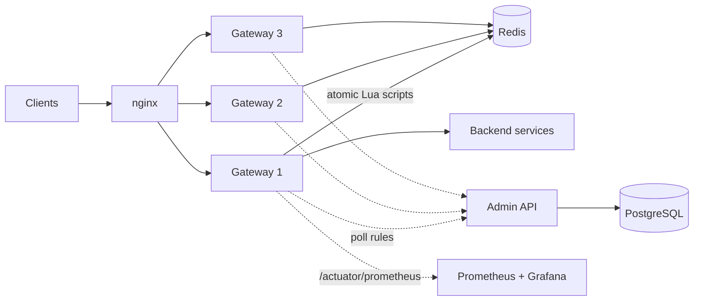
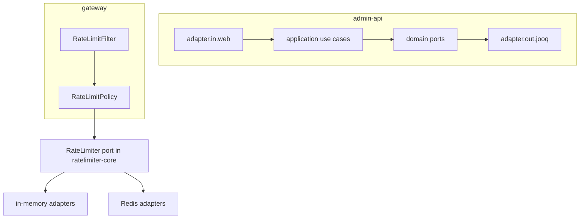

# distributed-rate-limiter

[](https://github.com/jacksonvieira/distributed-rate-limiter/actions/workflows/ci.yml)

[](LICENSE)

A distributed rate limiter and lightweight API gateway built with Java and Redis.

The goal is a rate limiter that behaves the same whether one or many gateway instances
are running, offers several algorithms with documented trade-offs, and stays fast and
predictable under load. Each algorithm ships with an in-memory reference implementation
and a Redis-backed implementation that shares state across instances through atomic Lua scripts.

> **Status:** feature complete. Four algorithms (in-memory and Redis), a reactive gateway with metrics and a circuit breaker,
> an admin API with hot reload, and JMH benchmarks. See the [roadmap](#roadmap).

## Architecture



Each request goes through the rate limit filter, which picks the rule for the path, builds the key (client IP or header)
and asks the limiter. If Redis fails, a circuit breaker switches to a local limiter or applies the configured fail mode.



### Ports and adapters

The project follows a hexagonal layout, with dependencies always pointing towards the core:

- **Port:** `RateLimiter` in `ratelimiter-core`, with no framework or I/O dependency.
- **Adapters:** `InMemoryTokenBucketRateLimiter` (core) and `RedisTokenBucketRateLimiter` (`ratelimiter-redis`) implement the port; the `gateway` is the driving adapter that calls it.
- The gateway picks the adapter from configuration and calls the (blocking) port off the event loop.
- ArchUnit tests in each module fail the build if the core starts depending on an adapter or a framework.

Design decisions are recorded in [docs/adr](docs/adr/README.md).

### Modules

| Module | Status | Description |
| --- | --- | --- |
| `ratelimiter-core` | in progress | Algorithms and the `RateLimiter` port, with in-memory implementations |
| `ratelimiter-redis` | in progress | Redis-backed implementations that share state through atomic Lua scripts |
| `gateway` | in progress | Reactive reverse proxy applying rules per route, key and plan |
| `admin-api` | in progress | REST API to manage rules at runtime, stored in PostgreSQL (Flyway migrations) |
| `benchmarks` | done | JMH benchmarks comparing the in-memory algorithms |

## Algorithms

| Algorithm | Burst handling | Memory per key | Accuracy | Status |
| --- | --- | --- | --- | --- |
| Token bucket | Allows bursts up to capacity | O(1) | Exact | ✅ in-memory · ✅ Redis |
| Fixed window counter | Bursts at window edges | O(1) | Approximate | ✅ in-memory · ✅ Redis |
| Sliding window log | No bursts | O(requests) | Exact | ✅ in-memory · ✅ Redis |
| Sliding window counter | Smoothed | O(1) | Approximate | ✅ in-memory · ✅ Redis |

### Token bucket

Each key owns a bucket holding at most `capacity` tokens. Tokens are refilled continuously at
`refillTokens` per `refillPeriod`, and every request consumes one or more tokens.

The in-memory implementation is lock-free: each bucket is an immutable state object updated through
a compare-and-set loop, so concurrent requests for the same key never receive more permits than
the bucket holds. Refill is computed lazily on access, so there are no background threads.

### Fixed window counter

Time is split into consecutive windows and each key may use at most `limit` permits per window.
It needs a single counter per key, but a client can use up to twice the limit around a window
boundary (the end of one window plus the start of the next). `Retry-After` is the time left in the
current window.

### Sliding window log

Stores the timestamp of every granted permit and allows a request only if fewer than `limit` permits
were granted in the last `window`. It is exact and has no boundary burst, but memory grows with the
permits granted within the window (up to `limit` per key). `Retry-After` is the time until enough old
permits leave the window.

### Sliding window counter

Keeps a counter for the current window and one for the previous window, and estimates the load as
`previous * (1 - elapsed) + current`. It needs O(1) memory per key and softens the fixed window's
boundary burst, but assumes the previous window's requests were evenly spread, so it is approximate.
`Retry-After` is the time until the estimate fits the request again.

## Usage

```java
// Bursts of up to 100 requests, sustained rate of 10 requests per second.
RateLimiter limiter = new InMemoryTokenBucketRateLimiter(
        new TokenBucketConfig(100, 10, Duration.ofSeconds(1)));

RateLimitResult result = limiter.tryAcquire("api-key-123");
if (!result.allowed()) {
    // Respond with 429 Too Many Requests and Retry-After: result.retryAfter()
}
```

`RateLimitResult` carries everything needed for the standard headers:
`X-RateLimit-Limit`, `X-RateLimit-Remaining` and `Retry-After`.

## Gateway

The `gateway` module is a reactive reverse proxy (Spring Boot 4, WebFlux). For now it serves one
route: every request under `path-prefix` goes through the rate limit and, if allowed, is forwarded
to `uri`. Request and response bodies are streamed, never buffered.

```yaml
gateway:
  route:
    path-prefix: /api            # /api/users -> http://localhost:8081/users
    uri: http://localhost:8081
    strip-prefix: true
    connect-timeout: 2s
    response-timeout: 30s
  rate-limit:
    capacity: 100                # burst size
    refill-tokens: 10            # sustained rate: 10 requests...
    refill-period: 1s            # ...per second
    key: ip                      # ip | header
    key-header: X-API-Key        # used when key = header; falls back to the client IP
    on-error: fail-open          # fail-open | fail-closed, when the limiter itself fails
    algorithm: token-bucket      # token-bucket | fixed-window | sliding-window-log | sliding-window-counter
    store: memory                # memory | redis (redis shares one limit across all instances)
    redis:
      uri: redis://localhost:6379   # used when store = redis
      command-timeout: 1s           # a Redis command fails after this; commands fail at once while disconnected
```

| Situation | Response |
| --- | --- |
| Allowed | Backend response as is, plus `X-RateLimit-Limit` and `X-RateLimit-Remaining` |
| Bucket empty | `429 Too Many Requests` with `Retry-After` (seconds); the backend is not called |
| Limiter fails (e.g. Redis down) | `fail-open`: request goes through unlimited · `fail-closed`: `503 Service Unavailable` (unless the circuit breaker below is enabled) |
| Backend unreachable | `502 Bad Gateway` |
| Backend too slow | `504 Gateway Timeout` |
| Path outside the route | `404 Not Found`, not limited |

The `ip` key uses the TCP peer address, not `X-Forwarded-For`, because clients can set that header
to whatever they like. The gateway itself adds `X-Forwarded-For`, `X-Forwarded-Host` and
`X-Forwarded-Proto` for the backend, and drops hop-by-hop headers.

The in-memory limiters evict idle keys: every 1024 calls one caller sweeps the map and drops the keys
whose state equals a new key's (a bucket that would be full again, a window that has passed), so memory
follows the number of recently active clients. There is no background thread. Redis expires keys with
`PEXPIRE`.

### Rules

`gateway.rules` overrides parts of the default limit for the requests it matches. Rules are checked in
order and the first match wins; anything else uses `gateway.rate-limit`. Every field but `name` is
optional and inherited from the default when omitted.

```yaml
gateway:
  plan-header: X-Plan             # header matched against a rule's plan
  rules:
    - name: login                 # stricter limit on a sensitive endpoint
      path-prefix: /api/login
      capacity: 5
      algorithm: fixed-window
      refill-period: 1m
    - name: premium               # bigger quota for a paying plan
      plan: premium
      capacity: 1000
      refill-tokens: 100
```

`path-prefix` is compared with the full request path (including the route prefix) and `plan` with the
plan header. Each rule counts on its own, so a client has independent counters under different rules.
Every algorithm is available with both `store=memory` and `store=redis`.

The plan header is sent by the client, so anyone can claim `premium`. To prevent that, map API keys to plans:
the plan is then taken from the key (`rate-limit.key-header`) and the plan header is ignored.

```yaml
gateway:
  plan-by-api-key:
    key-of-a-paying-customer: premium
```

### Threading

`spring.threads.virtual.enabled=true` runs Spring's task executors on virtual threads, and the
blocking limiter call (Redis) runs on Reactor's `boundedElastic` scheduler backed by virtual threads,
so it never blocks the Netty event loop. Lombok (`@Slf4j`, etc.) is available in the gateway module;
the core module stays dependency-free.

### Circuit breaker and local fallback

With `store=redis`, set `gateway.rate-limit.redis.circuit-breaker.enabled=true` to degrade gracefully when
Redis is down. After `failure-threshold` consecutive errors the circuit opens and requests are limited by an
in-memory limiter of the same algorithm for `open-duration` (no waiting on Redis timeouts); then one request
probes Redis and a success closes the circuit. During the outage each instance enforces the limit on its
own, so the effective global limit can be up to N times higher with N instances.

### Metrics

The gateway exposes Prometheus metrics at `/actuator/prometheus`. Every decision increments
`ratelimiter_decisions_total{rule, outcome}`, where `outcome` is `allowed`, `rejected` or
`limiter_failed` (the limiter backend errored and the failure mode decided the result). Requests
that match no rule are reported under `rule="default"`.

With the cluster profile, Prometheus (`localhost:9090`) scrapes the three gateways and Grafana
(`localhost:3000`, anonymous access, local use only) ships a provisioned **Rate limiter** dashboard:
decisions per second by outcome, rejections per rule, rejection ratio and limiter failures.

Alert rules live in `deploy/alerts.yml` (loaded by Prometheus): `GatewayDown`, `RateLimiterFailing`
(any `limiter_failed` decisions) and `HighRejectionRatio` (more than 50% rejected for a rule over 5 minutes).
Validate them with `promtool check rules deploy/alerts.yml`.

### Tracing

The gateway uses Micrometer Tracing with the OpenTelemetry bridge. It continues the caller's W3C `traceparent`
(or starts a new trace), forwards it to the backend and to the admin API, and prints `[gateway,traceId,spanId]` on
every log line. Reactor context propagation is enabled, so the ids survive reactive hops. Outgoing calls use the
auto-configured `WebClient.Builder`, which is what adds the header.

With the cluster profile, spans are exported over OTLP/HTTP to Jaeger (UI at `localhost:16686`). nginx forwards
`traceparent` and `tracestate`, so a call such as
`curl -H 'traceparent: 00-4bf92f3577b34da6a3ce929d0e0e4736-00f067aa0ba902b7-01' -H 'X-API-Key: k' localhost:8000/api/x`
shows up in Jaeger under that trace id. Outside compose, set
`management.opentelemetry.tracing.export.otlp.endpoint` to your collector.

Every gateway response carries the trace id in `X-Trace-Id`, so a client can quote it when reporting a problem and
you can look it up in Jaeger or grep the logs for it.

## Admin API

The `admin-api` module stores rules in PostgreSQL (schema managed by Flyway) and exposes a CRUD API
on port 8090. Rules are ordered by creation; the first match wins, as in the gateway.

```bash
docker run -d --name rl-pg -p 5432:5432 -e POSTGRES_DB=ratelimiter \
  -e POSTGRES_USER=ratelimiter -e POSTGRES_PASSWORD=ratelimiter postgres:17-alpine
java -jar admin-api/target/admin-api-0.1.0-SNAPSHOT.jar
curl -X POST localhost:8090/api/rules -H 'Content-Type: application/json' \
  -d '{"name":"login","pathPrefix":"/api/login","capacity":5,"refillTokens":1,"refillPeriod":"PT1M","algorithm":"FIXED_WINDOW","key":"HEADER"}'
```

Endpoints: `GET/POST /api/rules`, `GET/PUT/DELETE /api/rules/{id}`. Each rule carries HATEOAS `self` and `rules` links
(added to the rule's own fields, so existing clients keep working). Interactive docs (Swagger UI) at
`/swagger-ui.html`, OpenAPI document at `/v3/api-docs`. `refillPeriod` is an ISO-8601
duration. Errors follow RFC 9457 (`404` unknown rule, `409` duplicate name, `400` invalid input).

### Hot reload of rules

The gateway can poll the admin API and swap its rules at runtime, with no restart. It is disabled by default.

```yaml
gateway:
  admin-api:
    enabled: true
    url: http://localhost:8090
    refresh-interval: 10s
    timeout: 3s
```

Unchanged rules keep their counters across reloads. If the admin API is unreachable or returns invalid data, the gateway logs a warning and keeps the current rules.

### Securing the admin API

Set `admin.api-key` (or `ADMIN_APIKEY`) and every call to `/api/**` must send it in the `X-API-Key` header, otherwise the
answer is `401`. Swagger UI stays open. Without the setting the API is open, which is fine for local use only.
The gateway sends its key from `gateway.admin-api.api-key`. The compose cluster uses `ADMIN_API_KEY`
(default `dev-admin-key`).

Every response also carries `X-Content-Type-Options: nosniff`, `X-Frame-Options: DENY` and `Referrer-Policy: no-referrer`,
and answers under `/api/` are `Cache-Control: no-store`. Requests declaring a body above `admin.max-body-bytes`
(default 16384) get `413`.

Calls to `/api/**` are rate limited per client address with the project's own token bucket, ahead of the API key check
so key guessing is slowed down too. Over the limit the answer is `429` with `Retry-After`. Tune it with
`admin.rate-limit.burst` (default 100) and `admin.rate-limit.requests-per-minute` (default 600), or turn it off with
`admin.rate-limit.enabled=false`. Behind a proxy every call shares the proxy's address, so raise the limits there.

### TLS

Both the admin API and the gateway are Spring Boot applications, so HTTPS is switched on with the standard
`server.ssl.*` properties (or `SERVER_SSL_*` variables), for example:

```bash
keytool -genkeypair -alias dev -keyalg RSA -keysize 2048 -storetype PKCS12 -keystore keystore.p12 \
  -storepass changeit -dname CN=localhost -ext san=dns:localhost -validity 365

SERVER_SSL_KEY_STORE=file:keystore.p12 SERVER_SSL_KEY_STORE_PASSWORD=changeit SERVER_SSL_KEY_STORE_TYPE=PKCS12 \
  java -jar admin-api/target/admin-api-0.1.0-SNAPSHOT.jar
```

Point `gateway.admin-api.url` at an `https://` address and the gateway talks to the admin API over TLS, trusting the
JVM's trust store. An integration test starts the admin API with a generated keystore and calls it over HTTPS.

### Tracing

The admin API uses Micrometer Tracing with the OpenTelemetry bridge. Incoming `traceparent` headers (W3C Trace Context)
are honoured, and every log line carries `[application,traceId,spanId]` through the MDC. Sampling is 100% by default
(`management.tracing.sampling.probability`).

### Database schema and jOOQ

The schema is versioned with Flyway (`admin-api/src/main/resources/db/migration`). At build time jOOQ generates
type-safe table and record classes from those same scripts (`DDLDatabase`, no running database needed) into
`target/generated-sources/jooq`. The generated code lives under `adapter.out.jooq.generated`, and an ArchUnit rule
keeps jOOQ confined to that adapter.

The `V2` migration seeds two default rules (`default-api`: token bucket, 100 per minute per IP under `/api/`;
`default-fallback`: fixed window, 1000 per minute per IP). Edit or delete them through the admin API.

### Contract tests

`contracts/rules-list.json` describes the `GET /api/rules` response. The admin API's `RulesContractTest` checks it produces that shape and the gateway's `AdminApiContractTest` checks it can read it, so a breaking change on either side fails the build.

## Benchmarks

The `benchmarks` module has JMH benchmarks that compare the in-memory algorithms under concurrent load, on one
hot key and on many keys.

```bash
mvn -q -pl benchmarks -am package -DskipTests
java -jar benchmarks/target/benchmarks.jar                      # full run
java -jar benchmarks/target/benchmarks.jar -p algorithm=FIXED_WINDOW   # a single algorithm
```

Results depend on the machine, so run them on your own hardware before comparing.

## Container images

Every push to `main` and every `v*` tag publishes the gateway and admin API images to GitHub Container Registry:

```bash
docker pull ghcr.io/jacksonvieira/ratelimiter-gateway:edge
docker pull ghcr.io/jacksonvieira/ratelimiter-admin-api:edge
```

Tagged releases also get `X.Y.Z` and `X.Y` tags. The images are built from the root `Dockerfile` (build argument `MODULE`).

Hardening: the image runs as a non-root numeric user (10001), works with a read-only root filesystem (mount `/tmp`), sizes the heap from the container limit, and CI scans each image with Trivy and blocks the publish on fixable critical vulnerabilities. The Kubernetes manifests drop all capabilities and set a read-only root filesystem.

## Kubernetes

`deploy/k8s` holds Kustomize manifests for Redis, PostgreSQL, the admin API and a 3-replica gateway (probes, resource limits, PodDisruptionBudget, Prometheus scrape annotations):

```bash
kubectl apply -k deploy/k8s
```

The images come from GHCR (see above). `secret.yaml` contains development defaults only, and `GATEWAY_ROUTE_URI` must point to your own backend service.

## Mutation testing

`make mutation` runs [PIT](https://pitest.org) against `ratelimiter-core` and fails when fewer than 80% of the mutants are killed. The report is written to `ratelimiter-core/target/pit-reports/index.html`.

## Code style

`mvn verify` runs Spotless and fails on unused imports, trailing whitespace or a missing final newline.
Run `mvn spotless:apply` to fix them.

## Getting started

Requirements: JDK 25, Maven 3.9+, Docker (for Redis and the multi-instance setup).

A `Makefile` wraps the common tasks; run `make help` to list them:

```bash
make verify                # build, run the tests, check formatting and coverage
make format                # apply Spotless
make redis-up              # Redis on localhost:6379 (make postgres-up for PostgreSQL)
make run-gateway           # one gateway on :8080
make run-admin             # admin API on :8090 against the local PostgreSQL
make cluster-up            # the whole cluster; make cluster-down to stop it
```

The plain commands still work, for example `mvn verify` and `docker compose up -d`.

Run three gateway instances sharing one limit, behind an nginx load balancer on port 8000
(capacity 10, one token per second, clients identified by `X-API-Key`):

```bash
docker compose --profile cluster up -d --build
for i in $(seq 1 13); do
  curl -s -o /dev/null -D - -H 'X-API-Key: demo' localhost:8000/api/ | grep -iE '^HTTP|x-upstream'
done                       # 10 x 200, then 429, whichever instance answers
docker compose --profile cluster down
```

To check the shared limit under concurrency, run `scripts/load_check.py` while the cluster is up. It sends 500 requests
from 32 threads with one key and verifies that only about `capacity + refill * elapsed` were accepted. On a laptop it
accepted 10 of 500, spread over 3 instances, at roughly 900 req/s.

The cluster also starts PostgreSQL and the admin API on port 8090. The gateways poll it, so rules created
through `/api/rules` (Swagger UI at `/swagger-ui.html`) take effect without a restart.

Run a single gateway in front of a backend on port 8081:

```bash
mvn package -DskipTests
java -jar gateway/target/gateway-0.1.0-SNAPSHOT.jar
curl -i http://localhost:8080/api/anything
```

## Roadmap

1. **MVP:** in-memory token bucket ✅, gateway with a single route ✅, README ✅
2. **Distributed:** Redis implementation with Lua scripts ✅, Testcontainers ✅, Docker Compose with 3 gateway instances behind a load balancer ✅
3. **More algorithms:** fixed window, sliding window log and sliding window counter; rule configuration in YAML
4. **Observability:** Micrometer + Prometheus metrics ✅, Grafana dashboard ✅, `X-RateLimit-*` and `Retry-After` headers
5. **Dynamic rules:** admin REST API ✅, rules in PostgreSQL with Flyway ✅, hot reload in the gateway ✅
6. **Resilience:** local fallback when Redis is down ✅, fail-open / fail-closed modes ✅, circuit breaker ✅
7. **Benchmarks:** published results comparing the algorithms

## License

[MIT](LICENSE)
